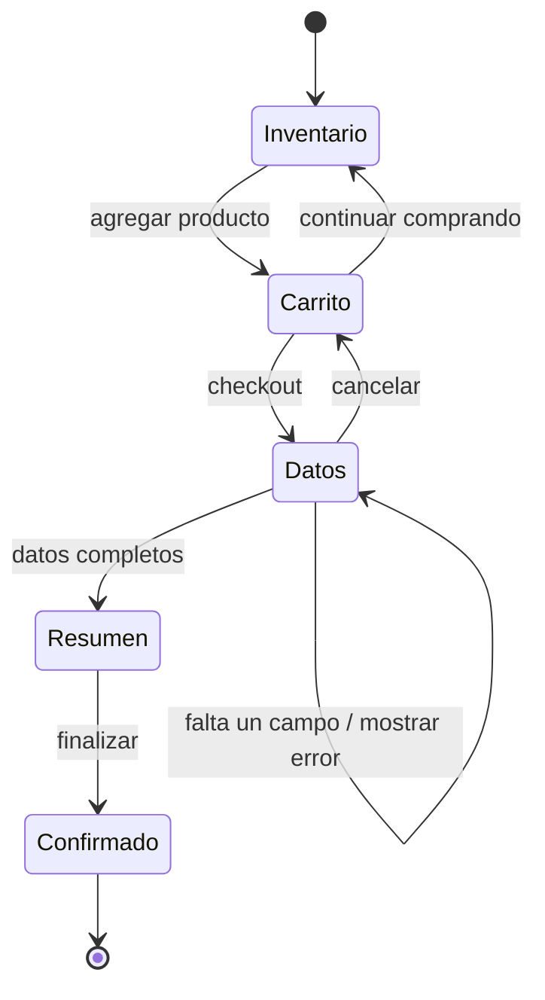

# Casos de prueba

Precondición general: sitio disponible; configurar la cuenta de demostración mediante `SWAGLABS_TEST_USER` y `SWAGLABS_TEST_PASSWORD` e iniciar sesión, salvo que el caso diga lo contrario. Los productos se identifican por sus slugs de demostración. Los datos del comprador son ficticios.

| ID | Escenario y pasos resumidos | Resultado esperado | Tipo |
|---|---|---|---|
| CP-01 | Agregar mochila desde inventario | Botón cambia a Remove y contador=1 | Positivo |
| CP-02 | Agregar mochila y luz | Contador=2 | Positivo |
| CP-03 | Agregar y retirar mochila en inventario | Contador vuelve a 0 | Positivo |
| CP-04 | Agregar dos productos y abrir carrito | Aparecen ambos productos; cantidad=2 | Positivo |
| CP-05 | Retirar artículo desde el carrito | Artículo desaparece; contador se actualiza | Positivo |
| CP-06 | En carrito, elegir Continue Shopping | Regresa a Products y conserva selección | Navegación |
| CP-07 | Checkout con nombre vacío | Mensaje indica First Name | Negativo |
| CP-08 | Checkout con apellido vacío | Mensaje indica Last Name | Negativo |
| CP-09 | Checkout con código postal vacío | Mensaje indica Postal Code | Negativo |
| CP-10 | Completar datos válidos | Se muestra resumen con un artículo | Positivo |
| CP-11 | Revisar resumen de mochila | Se muestran subtotal, impuesto y total | Positivo |
| CP-12 | Validar relación de importes | Total = subtotal + impuesto (±0,01) | Cálculo |
| CP-13 | Finalizar compra válida | Mensaje “Thank you…” | Positivo |
| CP-14 | Comprar dos artículos | Resumen enumera los dos | Positivo |
| CP-15 | Cancelar desde formulario de datos | Regresa al carrito | Navegación |

## Trazabilidad

| Requerimiento | Casos |
|---|---|
| RF-COM-01 | CP-01 |
| RF-COM-02 | CP-02, CP-03, CP-05 |
| RF-COM-03 | CP-04, CP-06 |
| RF-COM-04 | CP-07, CP-08, CP-09, CP-10 |
| RF-COM-05 | CP-10, CP-11, CP-12, CP-14 |
| RF-COM-06 | CP-13 |

## Técnica: tabla de decisión para validación del checkout

Y = sí; N = no. La primera condición incumplida determina el mensaje esperado.

| Regla | Nombre presente | Apellido presente | Código postal presente | Resultado |
|---|---:|---:|---:|---|
| R1 | N | — | — | Error: nombre requerido (CP-07) |
| R2 | Y | N | — | Error: apellido requerido (CP-08) |
| R3 | Y | Y | N | Error: código postal requerido (CP-09) |
| R4 | Y | Y | Y | Navegar al resumen (CP-10) |

## Técnica: transición de estados del flujo

Se usan dos técnicas de diseño explícitas (tabla de decisión y transición de estados); sumar dos técnicas del trabajo común si la guía exige cuatro para todo el equipo.
